# Rejecta: access control, plans and admin console. Implementation report

**Date:** 3 Nov 2026  **Branch:** `feat/auth-system`  **Status:** built and tested locally, database migrated on Supabase, **not committed and not deployed**.

> **Viewing the diagrams:** the diagrams are Mermaid. They render on GitHub and GitLab. In VS Code, install the extension *Markdown Preview Mermaid Support*, then open the preview (Ctrl+Shift+V). Every diagram is followed by a plain-text explanation, so the report also reads fine without them.

---

## 1. Summary

Rejecta started as an open API: anybody could call any tool, there were no accounts, and the database did not exist. Today it got a complete access-control system.

| Area | What now exists |
|---|---|
| Accounts | Sign-up, sign-in, sign-out, sign out of all devices, change password, admin-issued password reset links |
| Auth engine | Our own JWT (Ed25519), rotating refresh tokens with theft detection, Argon2id passwords. **Supabase is used only as the Postgres database.** |
| Roles | `admin` and `user`. Admins must use two-factor authentication (TOTP) and get the unlimited **Lab** plan by default |
| Plans and limits | Plans, features, daily and monthly limits, per-user overrides, a global kill switch per feature, all editable by an admin |
| Quotas | Atomic, race-free counters. If a tool call fails, the user's credit is refunded |
| Admin console | 9 pages: overview, users, user detail, plans, plan editor, features, partners, usage, audit log |
| Partner API | OAuth2 client credentials for platforms such as ChemLabFlow: scoped, rotatable secrets, own plan and limits |
| Frontend | Login, sign-up, reset and account pages, a usage strip on every tool, show/hide password, frosted-glass loaders, server-side pagination |
| Hardening | Strict CORS, security headers, startup safety checks, request ids, audit log of every sensitive action |

**By the numbers**

| | |
|---|---|
| API routes | 53 (29 admin, 11 auth, 10 tools and health, 3 other) |
| Database | 13 tables in schema `app`, 7 Alembic migrations, 2 SQL functions for quotas |
| Backend tests | **173 passed**, 3 skipped (old async tests unrelated to this work) |
| Database checks | **51 of 51** security and integrity checks pass on Supabase |
| Code written | about 5,500 lines of Python (auth, routers, db, scripts) and about 3,600 lines of TypeScript (new frontend files) |
| Frontend | type-check and production build pass |

---

## 2. How we got here: decisions

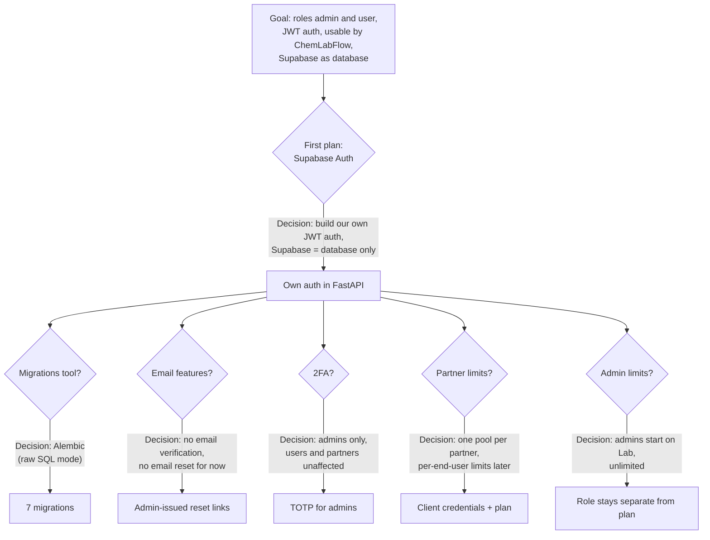

Decisions that were not made, on purpose: Google login, an email provider, and per-end-user limits inside a partner. All three can be added later without redesign.

---

## 3. System architecture

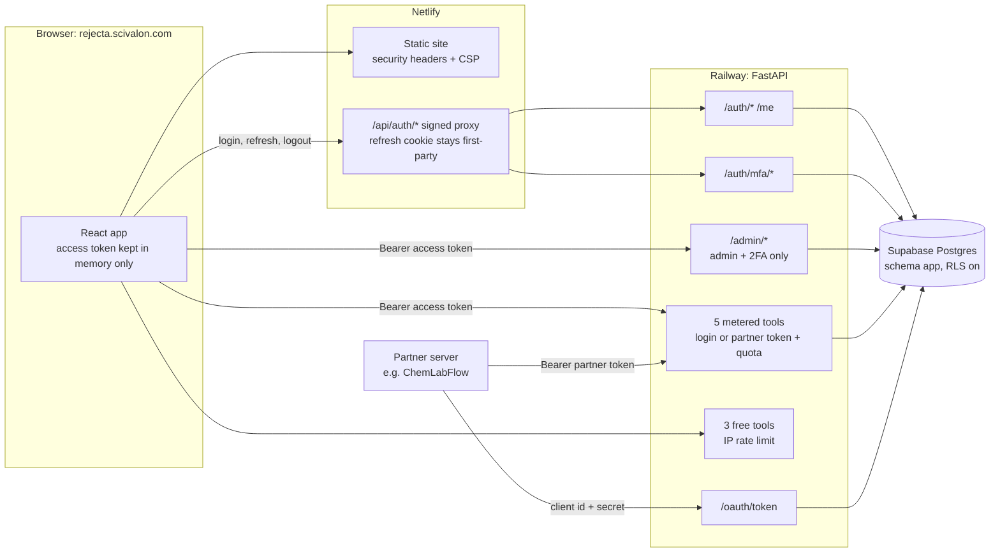

**Why auth goes through Netlify.** The API lives on `railway.app` and the site on `scivalon.com`. A cookie set by Railway would be a third-party cookie, which Safari and others block. The Netlify proxy makes the refresh cookie belong to the site itself.

**Why tools go direct.** Analysis calls take 15 to 45 seconds. Sending them straight to Railway avoids proxy timeouts.

---

## 4. Database

Supabase is used only as Postgres. Everything lives in schema `app`, which Supabase's public REST API does not expose. Row Level Security is on for every table and Supabase's own roles (`anon`, `authenticated`, `service_role`) have no access at all. The API connects as a separate low-privilege role, `rejecta_api`.

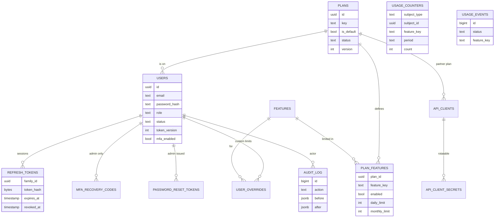

`USAGE_COUNTERS` and `USAGE_EVENTS` point at a user or a partner by id without a foreign key, because the subject can be either.

**Migrations (Alembic, raw SQL)**

| # | Content |
|---|---|
| 0001 | Schema `app`, the `rejecta_api` role, lockdown of Supabase roles |
| 0002 | 11 tables with constraints and triggers |
| 0003 | `consume_quota` and `finalize_usage` (atomic quotas with refunds) |
| 0004 | Seed: 5 features, 4 plans |
| 0005 | Absolute session lifetime |
| 0006 | Pending TOTP secret during enrollment |
| 0007 | Partner tables `api_clients` and `api_client_secrets` |

**Rules the database enforces by itself, whatever the API does**

- Exactly one active default plan exists at any time.
- A plan that still has users or partners cannot be archived or deleted.
- New users without a plan get the default plan.
- Changing a role, status, password or 2FA setting raises `token_version`, which invalidates every earlier token.
- The last active admin can never be demoted, suspended or deleted (concurrency-safe).
- Emails are stored trimmed and lower-case, and are unique.
- `audit_log` is append-only for the API role.
- Daily limit cannot exceed monthly limit.

**Starter plans (admins edit these in the console)**

| Feature | Free (default) | Researcher | Lab | Partner |
|---|---|---|---|---|
| Paper analysis | 3 / day | 20 / month | unlimited | unlimited |
| Voice Calibrator | 5 / day | 100 / month | unlimited | unlimited |
| Abstract Forge | 5 / day | 100 / month | unlimited | unlimited |
| Rebuttal Writer | 3 / day | 50 / month | unlimited | unlimited |
| AI Signal Heatmap | 20 / day | unlimited | unlimited | unlimited |

---

## 5. Authentication flows

### 5.1 Tokens at a glance

| Token | Form | Lifetime | Stored where |
|---|---|---|---|
| Access token | JWT, Ed25519 | 15 minutes | browser memory only, never localStorage |
| Refresh token | random 256-bit string `rt_…` | 30 days sliding, 90 days absolute | HttpOnly, Secure, SameSite=Strict cookie. The database keeps only its SHA-256 |
| MFA token | JWT, separate type and audience | 5 minutes, single use | memory, during admin sign-in |
| Partner token | JWT, separate type and audience | 15 minutes | partner's server |

Verification rejects `alg=none`, key-confusion (HS256), unknown key ids, wrong issuer or audience, expired or not-yet-valid tokens, and malformed claims. On every request the API also re-reads the user from the database, so a suspended user or a changed role takes effect immediately, not when the token expires.

### 5.2 Sign-up and sign-in (regular user)

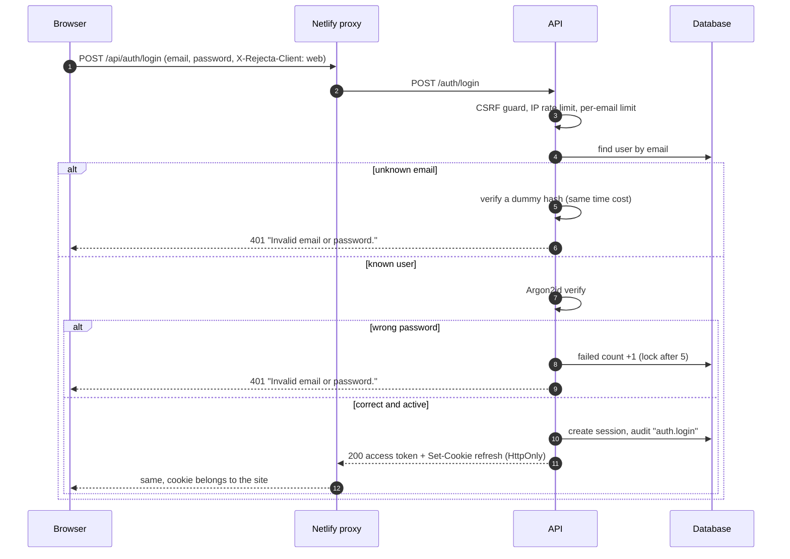

Sign-up works the same way but creates the account first (role `user`, default plan). A request body that contains `role` or `plan_id` is rejected, so nobody can sign themselves up as admin. The first admin is created only by a script run on the server; after that, only an existing admin (who has passed two-factor sign-in) can create or promote another one.

### 5.3 Admin sign-in with two-factor authentication

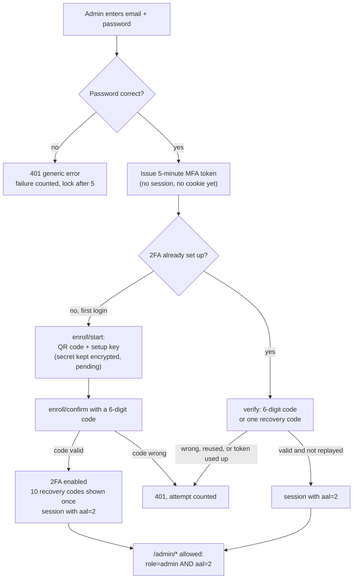

- A password alone never gives an admin a session.
- An MFA token cannot be used as an access token, and the other way round.
- A time step of the authenticator can be used only once (replay protection). Recovery codes work once each.
- 5 attempts per MFA token, and 10 failed codes per admin in 15 minutes.
- If an admin loses the phone and the recovery codes, someone with server access runs `create_admin --reset-mfa`.

### 5.4 Refresh tokens: rotation and theft detection

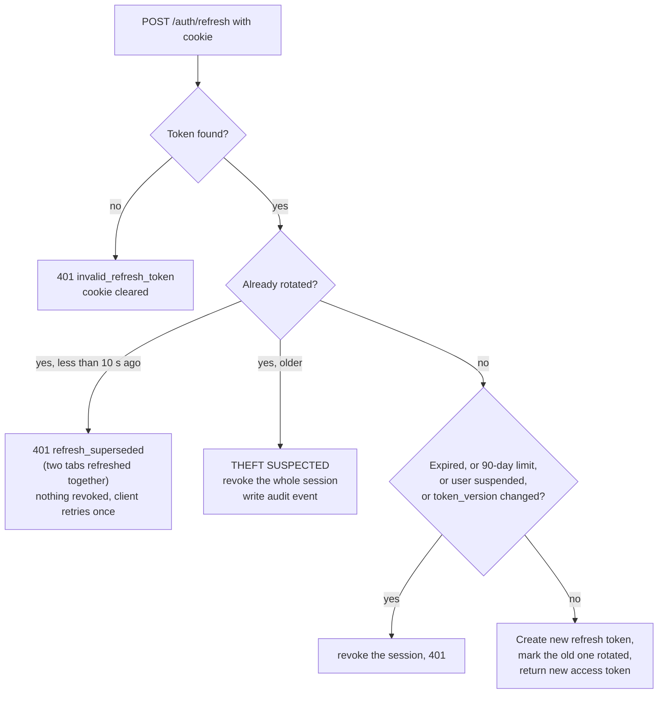

### 5.5 Passwords and brute force

- **Hashing:** Argon2id, run in worker threads (at most 4 at once, to bound memory).
- **Policy:** 10 to 128 characters; common passwords, repetitive passwords and the user's own email are refused. No forced symbols, following NIST guidance.
- **Limits:** sign-up 5 per hour per IP, sign-in 20 per 5 minutes per IP, 5 failures per email in 15 minutes (account lock stored in the database, so a restart does not clear it).
- **Same message for unknown and known emails**, with the same response time.

### 5.6 Password reset without email

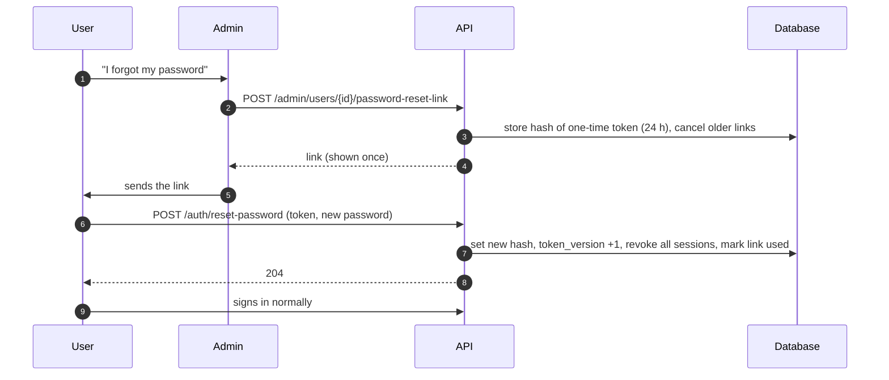

The same mechanism is used when an admin creates a new account. The admin never sees or chooses the password.

---

## 6. Authorization and quotas

### 6.1 What happens on every tool call

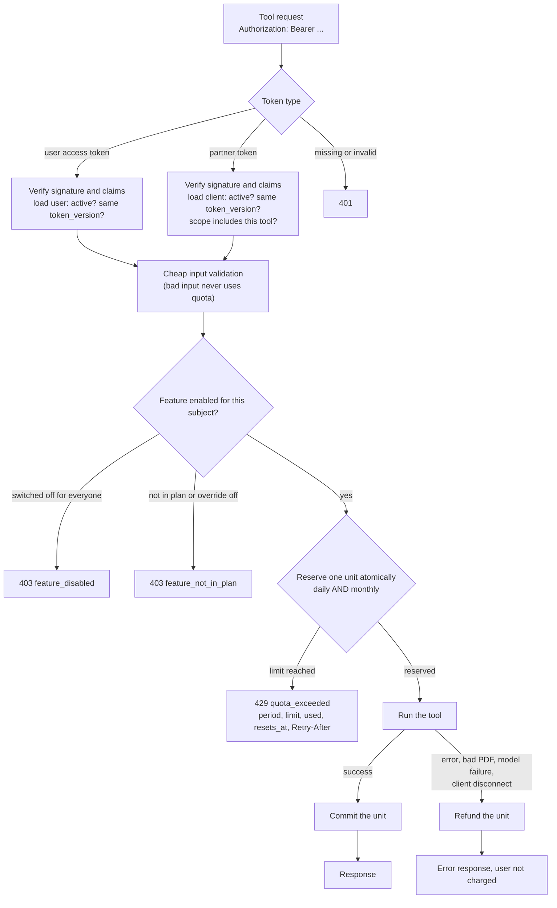

20 parallel requests against a limit of 3 let exactly 3 through; this is tested. Reservations left open by a crash are refunded when the API starts. Daily limits reset at 00:00 UTC and monthly limits on the 1st (UTC).

### 6.2 How a feature's access is decided

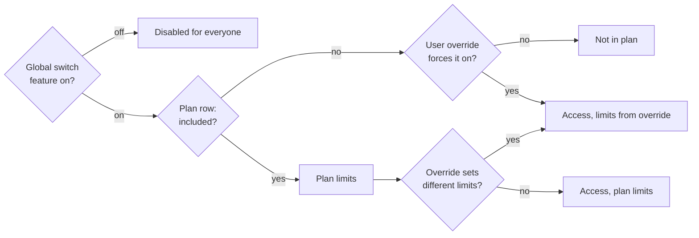

An override can change on/off, the daily limit, the monthly limit, or any mix of them, optionally with an expiry date and a reason. A `NULL` limit means unlimited. The global switch always wins.

### 6.3 Roles and plans are separate

| | Role | Plan |
|---|---|---|
| Decides | what you may manage (admin console) | how much of each tool you may use |
| Values | `admin`, `user` | Free, Researcher, Lab, Partner, and any plan admins create |
| Admins | need 2FA | start on **Lab** (unlimited); their usage is still counted |

Where the admin default applies: a new admin created by the script, a user promoted by the script, a new admin created in the console, and a user promoted in the console (unless the admin picks another plan). Demoting an admin keeps their plan.

---

## 7. Admin console

### 7.1 Page map

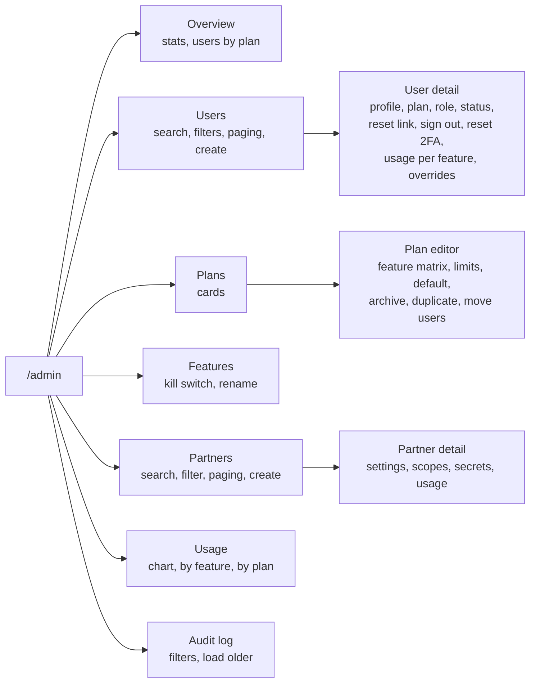

The console is loaded only when an admin opens it, so regular users never download that code.

### 7.2 Plan management in detail

The plan editor is the page for "manage all plans, their usage limits and which features they give".

- A matrix: one row per feature, with an on/off switch, a daily limit and a monthly limit. Each limit has an *Unlimited* checkbox.
- Validation before saving: daily limit cannot be higher than monthly.
- Unsaved changes are tracked, with a Discard button and a warning before leaving the page.
- Actions: make default for new sign-ups, archive and restore, duplicate, move all users and partners to another plan.
- Live usage of the plan for today or this month.
- A saved change applies from the next request. The server clears its caches.

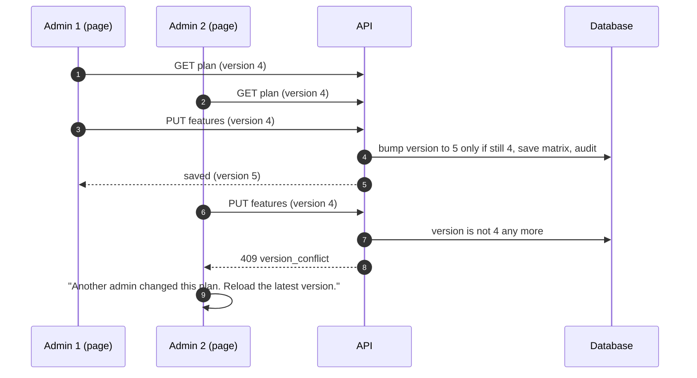

Safety rules enforced in the database: exactly one default plan; a plan with users cannot be archived (move them first); the last admin cannot be removed. In the API: an admin cannot change their own role or status.

### 7.3 Audit log

Every sign-in, failed sign-in, 2FA event, token-theft alert, partner token and admin change is recorded with the actor, the target, the before and after values, the IP address and the browser. Entries cannot be edited or deleted by the API.

---

## 8. Partner integration (ChemLabFlow)

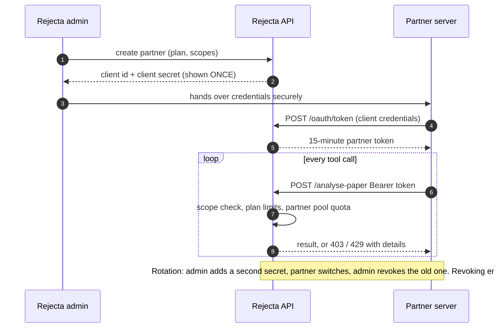

- Partner tokens work only on the tool endpoints, never on `/me`, `/auth/*` or `/admin/*`.
- One shared usage pool per partner, limited by the plan assigned to it.
- At most two active secrets; only a SHA-256 of each is stored.
- Disabling a partner, or changing its plan or scopes, ends its tokens.
- Guide for the partner's developers, with curl, Python and Node examples: [PARTNER_INTEGRATION.md](PARTNER_INTEGRATION.md).

---

## 9. Frontend

### 9.1 Structure

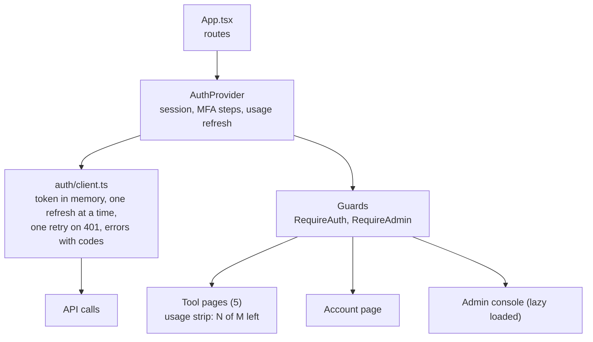

Key behaviours:

- The access token is never written to storage. After a page reload the session is restored silently from the refresh cookie.
- Several tabs refreshing at once are handled (Web Locks, plus one retry on `refresh_superseded`).
- A tool page shows "17 of 20 left today" before the user runs anything; the number updates after each run.
- The sign-in `next` parameter accepts same-site paths only (no open redirect).
- Every password field has a **show/hide eye button**.

### 9.2 Loaders

Before, every loading state was a tiny 16 px spinner in the corner and nothing else, so pages looked empty and broken.

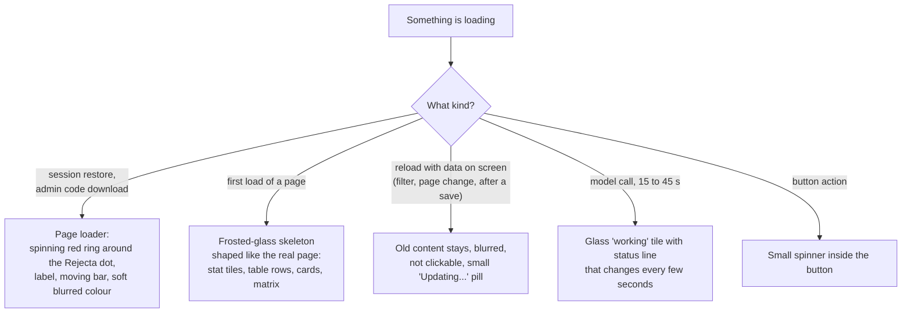

- Nothing is shown for the first 150 ms, so fast loads never flash a loader.
- Skeletons match the size of the real content, so the page does not jump when data arrives.
- Motion stops for people who use "reduce motion". Screen readers get "Loading…" announcements.
- No new library: CSS animations only.

### 9.3 Pagination

| List | How | Where |
|---|---|---|
| Users | page numbers, total count, page size 10 / 25 / 50 / 100, search and filters | backend and frontend (backend existed; frontend now uses the shared control) |
| Partners | same, plus search and status filter | **new** in backend and frontend |
| Audit log | cursor ("load older"), which is the right choice for an append-only log that keeps growing | backend and frontend |
| Plans, Features | not paginated on purpose: both lists are small, and the whole list is needed for dropdowns (a user's plan, the move-users target) | n/a |

The shared control shows "Showing 26–50 of 137", first, previous, numbered pages with gaps (`1 … 4 5 6 … 20`), next, last, and a per-page selector. If a filter makes the list shorter than the current page, it steps back to the last valid page. The backend rejects page 0 and page sizes above 100.

---

## 10. Security controls

| Threat | Control |
|---|---|
| Stolen password database | Argon2id; refresh tokens, reset tokens, partner secrets and recovery codes stored only as hashes; TOTP secrets encrypted |
| Stolen refresh token | rotation; reuse of an old token revokes the whole session and raises an audit alert |
| Brute-force sign-in | IP and per-email limits; database-backed lock after 5 failures; identical error and timing for unknown emails |
| Forged or confused tokens | EdDSA only; token types isolated by header type and audience; claims fully validated; user re-read on every request |
| Cross-site request forgery | SameSite=Strict cookie scoped to the auth path, required `X-Rejecta-Client` header, origin allow-list |
| Cross-site scripting | access token in memory only; strict Content-Security-Policy; no third-party scripts |
| Privilege escalation | first admin only by server script, later admins only by a 2FA-verified admin; role and plan fields rejected on sign-up; role read from the database; admin routes need 2FA |
| Stolen admin password | two-factor authentication, replay-proof codes, limited attempts |
| Leaked database access | Supabase roles have no access to schema `app`; the API role owns nothing and has timeouts; RLS on every table |
| Quota abuse | atomic counters; parallel requests cannot exceed the limit; refunds only for failed work |
| Rogue admin action | every change audited, append-only; admins cannot change their own role or status; last admin protected |
| Misconfigured production | the API refuses to start with unsafe settings; API docs hidden in production |
| Open API from any website | CORS limited to the app and its Netlify previews |

---

## 11. Problems found and fixed on the way

| Problem | Fix |
|---|---|
| Rolling back migration 0001 failed on Supabase (PG17 forbids `DROP OWNED BY` there) | rewritten to revoke grants and drop the role; full downgrade and upgrade tested |
| Tests failed on the second run because old data stayed in the test database | the test setup wipes and rebuilds the database every run; it refuses to touch Supabase |
| Heatmap and Abstract Forge ran the tool automatically when the page opened, and twice in development. With quotas, a page visit would have used credits | they now run only when the user clicks |
| Changing the password would have left the browser with a third-party cookie | that call now goes through the auth proxy |
| After sign-up, the sign-in time was empty | the first session now records it |
| Frontend called port 8000 while the API ran on 8001, so nothing reached it | added a frontend `.env`; the dev proxy now follows the same API setting |
| A first loader was too faint and looked broken | replaced with the ring loader and glass skeletons |
| Stray old text "no account" on the upload page | updated to say it uses one analysis from the plan |

---

## 12. Testing and what is verified

| Check | Result |
|---|---|
| Backend tests | **173 passed**, 3 skipped. They run against a real Postgres 17 container |
| Token attacks | `alg=none`, HS256 key confusion, tampered payload, unknown key, wrong audience, expired tokens, token-type swapping all rejected |
| Concurrency | 20 parallel quota calls against limit 3: exactly 3 allowed |
| Database | 51 of 51 security and integrity checks on Supabase; full downgrade and upgrade works |
| Frontend | TypeScript strict check and production build pass |
| Real browser run (local stack) | sign-up, session restore after reload, tool run with live counter, sign-out, admin first sign-in with QR and recovery codes, plan edit saved to the database and the audit log, all admin pages with no console errors |
| Port fix | proxy and CORS verified with direct requests |

**Honest gaps.** The new page loader, the skeletons, the tool "working" tile, the show/hide eye button and the pagination control were built and compile and the backend side is tested, but they have **not been looked at in a browser by me**. Please open them once. Also not done: a real run against the deployed Railway and Netlify, because nothing is deployed yet.

---

## 13. What happens next

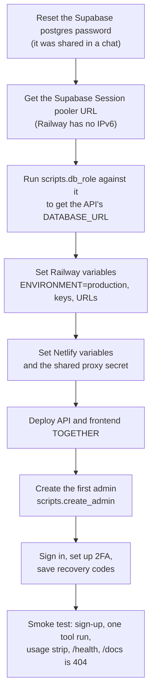

Deploy both sides together: once the new API is live, the tools need sign-in and the old frontend has no sign-in page. The full variable list is in [AUTH_IMPLEMENTATION.md](AUTH_IMPLEMENTATION.md), section 12.

**Open items**

| Item | Owner |
|---|---|
| Reset the Supabase password; keep `.env` private (it holds the database password and the signing keys) | you |
| Commit the branch and open a pull request | you decide when |
| Visual check of the loaders, eye button and pagination | you or me on request |
| Email provider, Google login, per-end-user partner limits | later, by decision |
| Move rate limits and caches to Redis if the API ever runs on more than one instance | later |

---

## 14. Where to find things

| What | Where |
|---|---|
| Detailed engineering log | [AUTH_IMPLEMENTATION.md](AUTH_IMPLEMENTATION.md) |
| Partner developer guide | [PARTNER_INTEGRATION.md](PARTNER_INTEGRATION.md) |
| Database notes | `rejecta-api/db/README.md` |
| Auth code | `rejecta-api/auth/`, `rejecta-api/routers/` |
| Migrations | `rejecta-api/db/migrations/versions/` |
| Admin scripts | `rejecta-api/scripts/` (`create_admin`, `generate_keys`, `db_role`, `verify_db`) |
| Frontend auth and admin | `rejecta-frontend/src/auth/`, `src/admin/`, `src/pages/admin/` |
| Loaders and shared UI | `rejecta-frontend/src/components/Loaders.tsx`, `AdminSkeletons.tsx`, `ui.tsx` |
